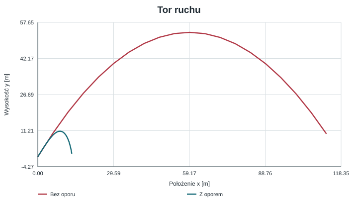
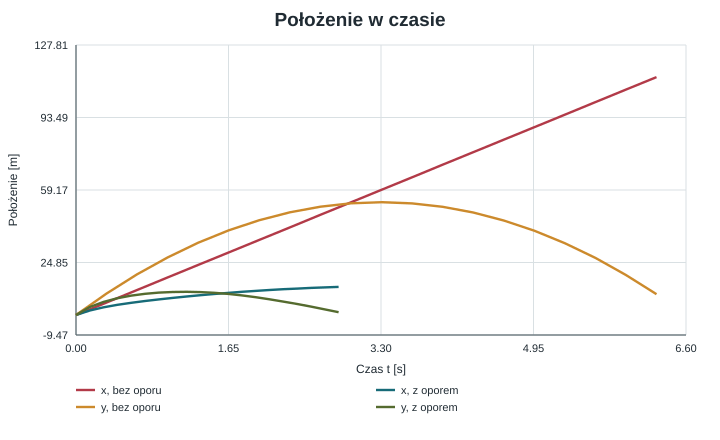
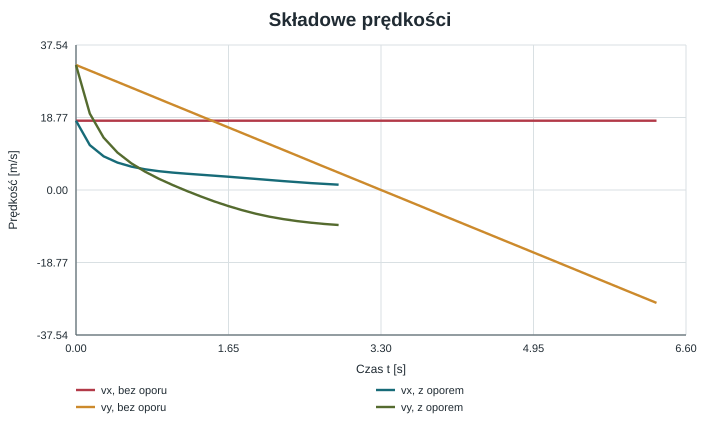
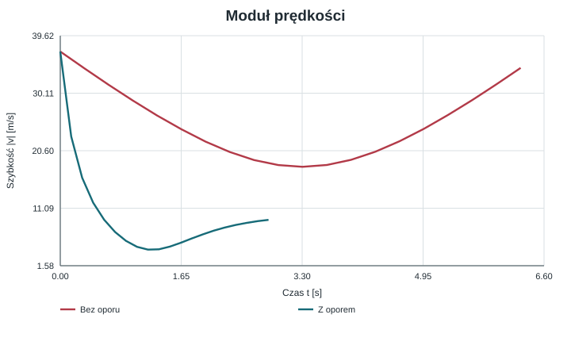
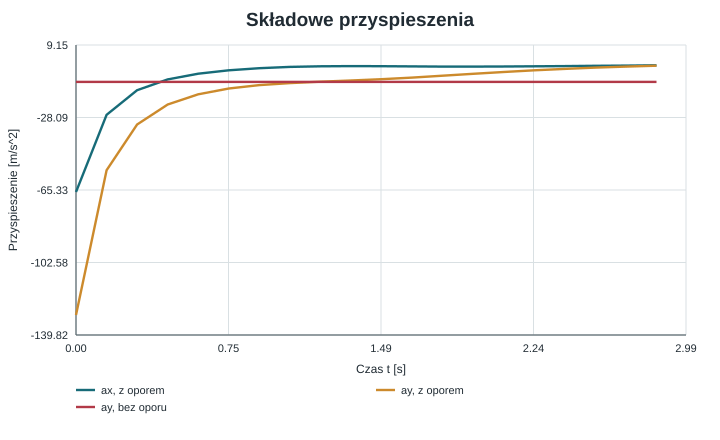
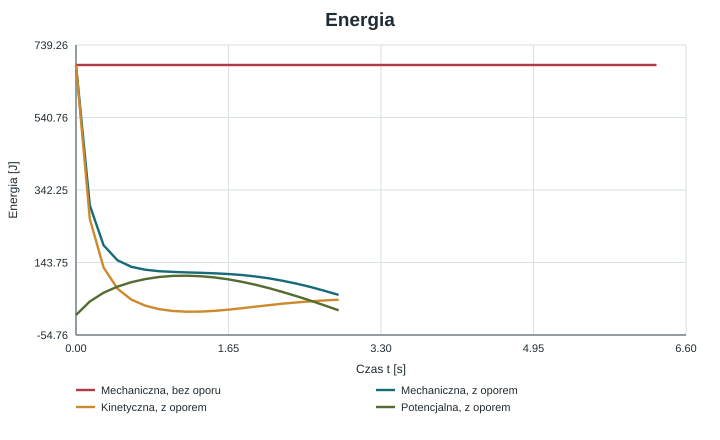

# Rzut ukośny bez oporu i z oporem powietrza

**Cel:** wyprowadzenie równań ruchu, porównanie toru, prędkości i energii oraz numeryczna symulacja rzutu ukośnego w dwóch modelach. Obliczenia i rysunki wykonano w Pythonie.

**Dane z numeru indeksu 374061:** dwie pierwsze cyfry wyznaczają $v_0=37\ \mathrm{m/s}$. Dwie ostatnie cyfry (61) określają kąt; po konwersji do jednostki SI otrzymujemy $\alpha=1{,}06465\ \mathrm{rad}$.

## Spis treści

1. [Założenia i parametry](#1-założenia-i-parametry)
2. [Model bez oporu](#2-model-bez-oporu-powietrza)
3. [Model z oporem](#3-model-z-oporem-powietrza)
4. [Metoda numeryczna](#4-metoda-numeryczna)
5. [Wyniki i wykresy](#5-wyniki-i-wykresy)
6. [Kod](#6-kod)
7. [Ograniczenia modelu](#7-ograniczenia-modelu)
8. [Wnioski](#8-wnioski)

## 1. Założenia i parametry

Ciało jest traktowane jako punkt materialny poruszający się w płaszczyźnie. Początek układu współrzędnych znajduje się w miejscu wyrzutu, oś $x$ jest pozioma, a oś $y$ skierowana pionowo w górę. Teren jest płaski, a ciało startuje i ląduje na wysokości $y=0$. Pomijamy wiatr i zmianę przyspieszenia grawitacyjnego.

| Wielkość | Symbol | Wartość | Jednostka SI |
|:--|:--:|--:|:--|
| Prędkość początkowa | $v_0$ | $37$ | $\mathrm{m/s}$ |
| Kąt wyrzutu | $\alpha$ | $1{,}06465$ | $\mathrm{rad}$ |
| Przyspieszenie grawitacyjne | $g$ | $9{,}81$ | $\mathrm{m/s^2}$ |
| Masa ciała | $m$ | $1{,}0$ | $\mathrm{kg}$ |
| Współczynnik oporu kwadratowego | $k$ | $0{,}1$ | $\mathrm{kg/m}$ |

Współczynnik $k$ odnosi się do przyjętego prawa $F_d=k|\vec v|^2$ i nie jest uniwersalną stałą powietrza. Jego wartość określa siłę oporu w symulacji.

Prędkość początkową rozkładamy na składowe:

$$
v_{0x}=v_0\cos\alpha\approx17{,}94\ \mathrm{m/s},\qquad
v_{0y}=v_0\sin\alpha\approx32{,}36\ \mathrm{m/s}.
$$

## 2. Model bez oporu powietrza

W modelu idealnym na ciało działa wyłącznie siła ciężkości. Z II zasady Newtona:

$$
m\ddot{x}=0,\qquad m\ddot{y}=-mg,
$$

czyli $\ddot{x}=0$ i $\ddot{y}=-g$. Całkując równania i stosując warunki początkowe $x(0)=y(0)=0$, $\dot{x}(0)=v_{0x}$ i $\dot{y}(0)=v_{0y}$, otrzymujemy:

$$
x(t)=v_0\cos\alpha\,t,\qquad
$$

### Tor i parametry rzutu

Z pierwszego równania $t=x/(v_0\cos\alpha)$. Po podstawieniu do równania wysokości dostajemy równanie toru:

$$
y(x)=x\tan\alpha-\frac{g x^2}{2v_0^2\cos^2\alpha}.
$$

Jest to parabola. Czas lotu wyznaczamy z warunku $y(t_l)=0$. Poza rozwiązaniem $t=0$ otrzymujemy $t_l=2v_0\sin\alpha/g$. Zasięg to $R=x(t_l)$, stąd $R=v_0^2\sin(2\alpha)/g$. W najwyższym punkcie $v_y=0$, zatem $t_H=v_0\sin\alpha/g$ i $H=v_0^2\sin^2\alpha/(2g)$.

Dla podanych parametrów:

- czas lotu: $t_l=6{,}598\ \mathrm{s}$,
- zasięg: $R=118{,}346\ \mathrm{m}$,
- maksymalna wysokość: $H=53{,}376\ \mathrm{m}$.

## 3. Model z oporem powietrza

Przyjmujemy kwadratowe prawo oporu, w którym siła jest skierowana przeciwnie do wektora prędkości:

$$
\vec F_d=-k|\vec v|\vec v,
\qquad |\vec v|=\sqrt{v_x^2+v_y^2}.
$$

Zapis $|\vec v|$ oznacza szybkość, a nie wartość bezwzględną jednej składowej. Współczynnik $k$ ma jednostkę $\mathrm{kg/m}$, ponieważ $k|\vec v|\vec v$ ma wymiar siły.

Po zastosowaniu II zasady Newtona do osi $x$ i $y$:

$$
\ddot{x}=-\frac{k}{m}\sqrt{\dot{x}^2+\dot{y}^2}\,\dot{x},\qquad
\ddot{y}=-g-\frac{k}{m}\sqrt{\dot{x}^2+\dot{y}^2}\,\dot{y}.
$$

Do całkowania numerycznego zapisujemy układ równań pierwszego rzędu:

$$
\begin{aligned}
\dot{x}&=v_x, & \dot{y}&=v_y,\\
\dot{v_x}&=-\frac{k}{m}\sqrt{v_x^2+v_y^2}\,v_x,
&\dot{v_y}&=-g-\frac{k}{m}\sqrt{v_x^2+v_y^2}\,v_y.
\end{aligned}
$$

Warunki początkowe są takie same jak w modelu idealnym: $(x,y,v_x,v_y)_{t=0}=(0,0,v_0\cos\alpha,v_0\sin\alpha)$. Rozwiązanie kończymy przy pierwszym ponownym przecięciu poziomu $y=0$ podczas opadania.

### Energia

Energia mechaniczna jest sumą energii kinetycznej i potencjalnej:

$$
E_m=E_k+E_p=\frac12m(v_x^2+v_y^2)+mgy.
$$

Mnożąc równanie ruchu przez prędkość i dodając wkład energii potencjalnej, otrzymujemy zmianę energii mechanicznej pod wpływem oporu:

$$
\frac{dE_m}{dt}=\vec F_d\cdot\vec v=-k|\vec v|^3\leq 0.
$$

Jednostką pochodnej energii po czasie jest wat ($\mathrm{J/s}$). W modelu idealnym $k=0$, więc energia mechaniczna pozostaje stała; w modelu z oporem maleje.

## 4. Metoda numeryczna

Układ z oporem nie ma tu prostego rozwiązania w postaci elementarnych funkcji. Wykorzystano `scipy.integrate.solve_ivp`, który adaptacyjnie całkuje układ równań. Zdarzenie opisane funkcją $y(t)=0$ ma kierunek ujemny i zatrzymuje obliczenia przy uderzeniu w podłoże, dzięki czemu czas i zasięg nie zależą od ręcznie dobranego końca przedziału czasu. Trajektorie wykreślono z 600 równomiernie rozmieszczonych próbek rozwiązania.

## 5. Wyniki i wykresy

Każdy wykres znajduje się na osobnym rysunku. Linie czerwone przedstawiają model bez oporu, a niebiesko-zielone model z oporem, o ile podpis nie opisuje składowej lub energii.

### 5.1. Tor ruchu

Parabola opisuje model idealny. Przy oporze tor jest krótszy i niesymetryczny: podczas wznoszenia prędkość pozioma jest tłumiona, więc ciało dociera do mniejszej wysokości i zasięgu.



Rysunek 1. Zależność wysokości $y$ od położenia poziomego $x$; osie w metrach.

### 5.2. Położenie w czasie

W modelu idealnym $x(t)$ rośnie liniowo. W modelu z oporem pozioma składowa ruchu stopniowo maleje. Współrzędna $y(t)$ najpierw rośnie, osiąga maksimum, a następnie maleje.



Rysunek 2. Współrzędne $x(t)$ i $y(t)$ w funkcji czasu $t$; czas w sekundach, położenie w metrach.

### 5.3. Składowe prędkości

Bez oporu $v_x$ jest stałe, a $v_y$ maleje liniowo z nachyleniem $-g$. Z oporem obie składowe zależą od chwilowej szybkości i nie zmieniają się liniowo.



Rysunek 3. Składowe $v_x(t)$ i $v_y(t)$; prędkość w metrach na sekundę.

### 5.4. Szybkość

Szybkość jest modułem wektora prędkości, $|\vec v|=\sqrt{v_x^2+v_y^2}$. Bez oporu osiąga minimum w wierzchołku toru, gdzie składowa pionowa wynosi zero. Opór szybko zmniejsza szybkość w początkowej fazie ruchu.



Rysunek 4. Moduł prędkości $|\vec v(t)|$ w metrach na sekundę.

### 5.5. Przyspieszenie

W modelu idealnym $a_x=0$ i $a_y=-g$. Przy oporze poziome przyspieszenie jest skierowane przeciwnie do ruchu, a pionowe jest sumą grawitacji i oporu; podczas opadania siła oporu działa ku górze.



Rysunek 5. Składowe przyspieszenia z oporem oraz poziom $-g$ modelu idealnego; jednostka $\mathrm{m/s^2}$.

### 5.6. Energia

Energia mechaniczna modelu idealnego jest stała. W modelu z oporem maleje, natomiast energia kinetyczna i potencjalna zamieniają się między sobą w trakcie lotu.



Rysunek 6. Energie w dżulach w funkcji czasu. Linia idealna przedstawia energię mechaniczną, która jest zachowana.

Wyniki symulacji dla modelu z oporem porównano z rozwiązaniem analitycznym:

| Wielkość | Bez oporu | Z oporem kwadratowym |
|:--|--:|--:|
| Czas lotu | $6{,}598\ \mathrm{s}$ | $2{,}985\ \mathrm{s}$ |
| Zasięg | $118{,}346\ \mathrm{m}$ | $13{,}465\ \mathrm{m}$ |
| Maksymalna wysokość | $53{,}376\ \mathrm{m}$ | $10{,}984\ \mathrm{m}$ |

W przyjętym modelu zasięg skraca się o około $88{,}6\%$, a maksymalna wysokość o około $79{,}4\%$. Tak duża różnica wynika z użycia $k=0{,}1\ \mathrm{kg/m}$ przy masie $1\ \mathrm{kg}$; nie należy traktować tych liczb jako prognozy dla dowolnego rzeczywistego pocisku.

Bez oporu składowa $v_x$ jest stała, zaś $v_y$ zmienia się liniowo w czasie. Przy oporze obie składowe są tłumione, a siła oporu maleje razem z szybkością. Tor przestaje być parabolą i nie jest symetryczny względem wierzchołka. Energia mechaniczna w modelu idealnym pozostaje na poziomie $E_m=\tfrac12mv_0^2=684{,}5\ \mathrm{J}$; w modelu oporowym maleje zgodnie z pracą siły oporu.

## 6. Kod

Pełny skrypt [generate_plots.py](generate_plots.py) generuje sześć osobnych plików PNG i sześć odpowiadających im plików SVG. Wymaga pakietów `numpy`, `scipy` i `matplotlib` (`python -m pip install numpy scipy matplotlib`). Poniższy fragment pokazuje równania i sposób zatrzymania całkowania w chwili upadku:

```python
import numpy as np
from scipy.integrate import solve_ivp

v0 = 37.0
alpha = np.deg2rad(61.0)  # konwersja dwoch cyfr indeksu do radianow SI
g, m, k = 9.81, 1.0, 0.1
v0x, v0y = v0 * np.cos(alpha), v0 * np.sin(alpha)

def projectile_with_drag(time, state):
    x, y, vx, vy = state
    speed = np.hypot(vx, vy)
    ax = -(k / m) * speed * vx
    ay = -g - (k / m) * speed * vy
    return vx, vy, ax, ay

def hit_ground(time, state):
    return state[1]

hit_ground.terminal = True
hit_ground.direction = -1

solution = solve_ivp(
    projectile_with_drag,
    (0, 20),
    (0, 0, v0x, v0y),
    events=hit_ground,
    dense_output=True,
    rtol=1e-9,
    atol=1e-11,
    max_step=0.02,
)

flight_time = solution.t_events[0][0]
impact_x = solution.y_events[0][0, 0]
print(f"Czas lotu: {flight_time:.3f} s; zasięg: {impact_x:.3f} m")
```

## 7. Ograniczenia modelu

- Ciało jest punktem materialnym, a podłoże jest poziome.
- Przyspieszenie $g$ jest stałe; pominięto wiatr, wypór, obrót Ziemi i zmianę orientacji ciała.
- Opór jest kwadratowy i opisany jednym stałym współczynnikiem $k$. W rzeczywistości współczynnik zależy m.in. od kształtu, pola przekroju i gęstości powietrza.
- Model służy do porównania równań i parametrów, a nie do dokładnej predykcji konkretnego obiektu bez pomiarów jego właściwości aerodynamicznych.

## 8. Wnioski

1. W próżni rzut ukośny jest superpozycją ruchu jednostajnego w poziomie i ruchu jednostajnie przyspieszonego w pionie, a jego tor jest parabolą.
2. Opór kwadratowy zależy od szybkości i działa przeciwnie do wektora prędkości; zmienia obie składowe ruchu i powoduje krótszy, niesymetryczny lot.
3. Dla $v_0=37\ \mathrm{m/s}$, $\alpha=1{,}06465\ \mathrm{rad}$, $m=1\ \mathrm{kg}$ oraz $k=0{,}1\ \mathrm{kg/m}$ symulacja daje zasięg $13{,}465\ \mathrm{m}$ i wysokość maksymalną $10{,}984\ \mathrm{m}$.
4. Energia mechaniczna jest zachowana tylko w modelu bez oporu; przy oporze jej ubytek jest równy pracy siły oporu.
5. Rozwiązanie numeryczne pozwala śledzić model bez prostego rozwiązania analitycznego, a zdarzenie $y=0$ precyzyjnie wyznacza koniec lotu.
